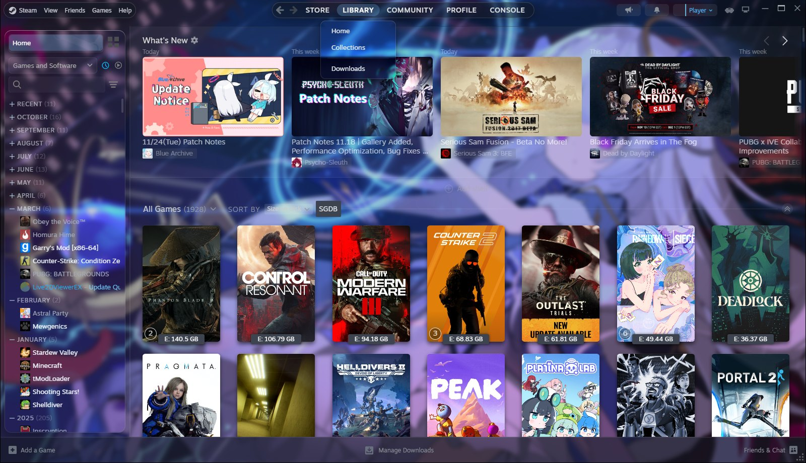
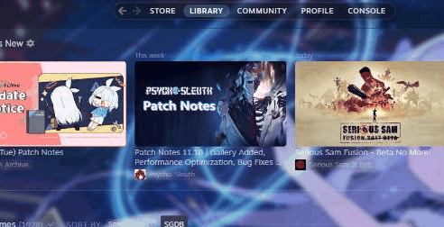
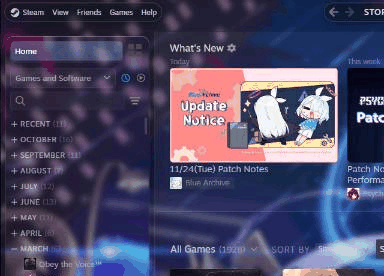
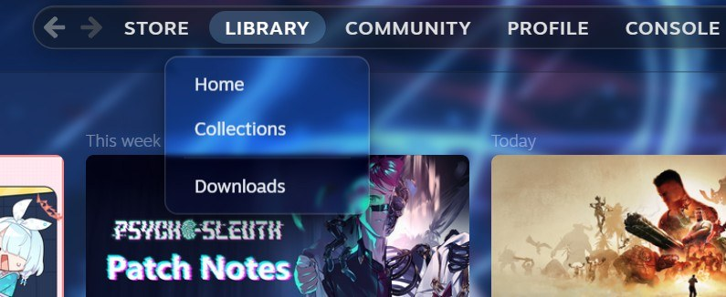
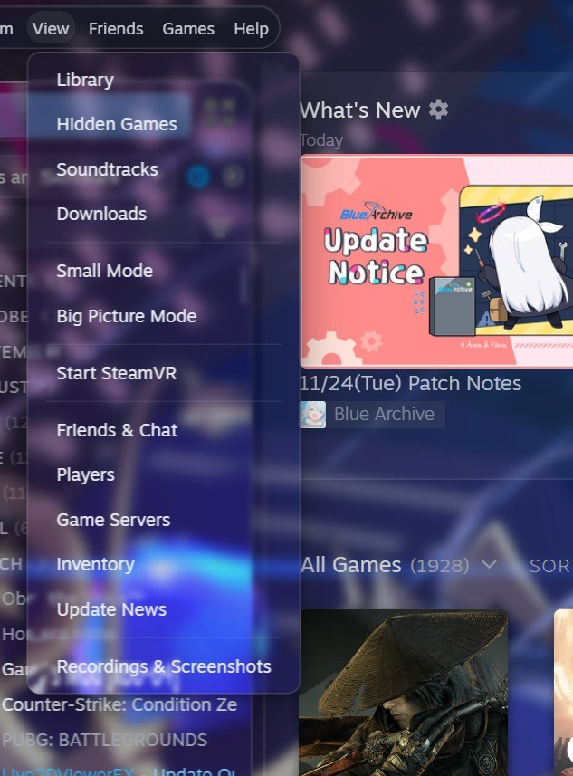
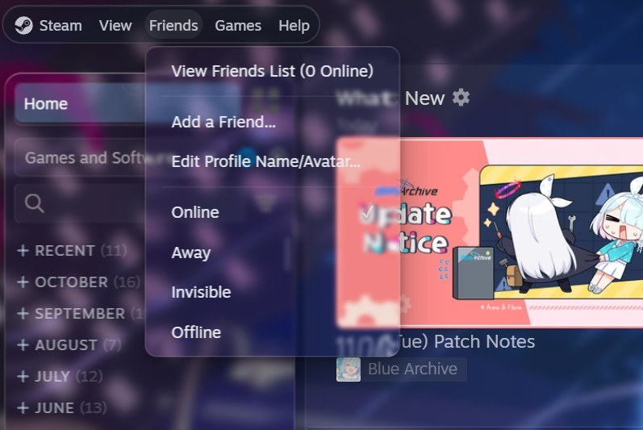
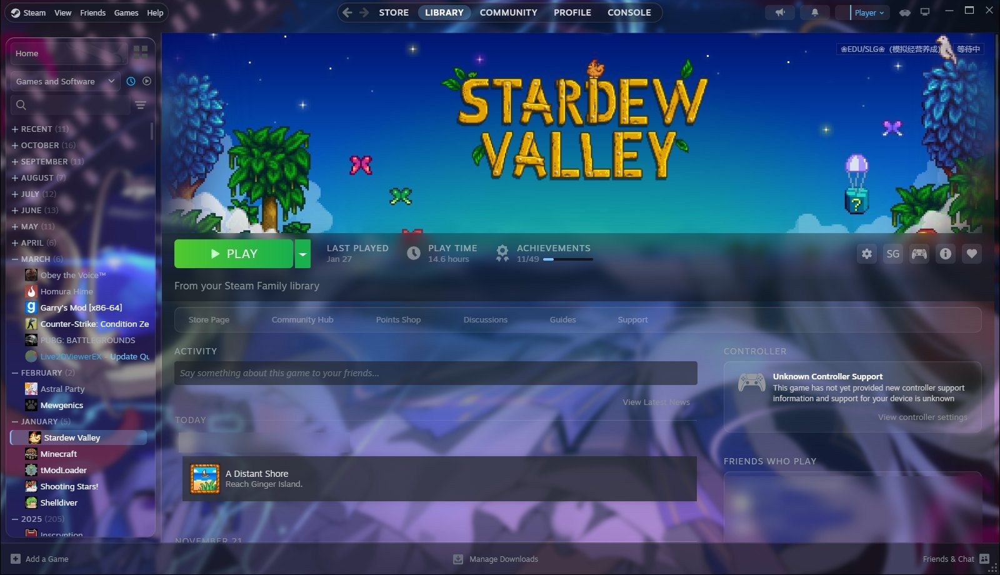
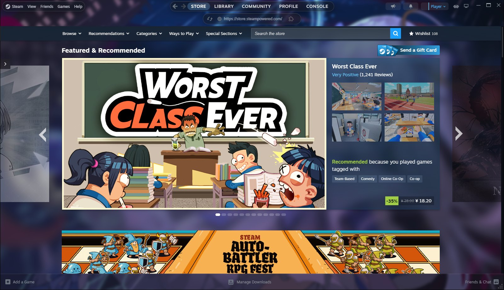

# Lumina

A glass theme for the Steam desktop client, built on [Millennium](https://steambrew.app): translucent panels and menus over a live wallpaper.

[中文](README.zh-CN.md)

| Morphing nav menu | Title bar menus |
|---|---|
|  |  |

| | | |
|---|---|---|
|  |  |  |

| Game page | Store |
|---|---|
|  |  |

Install Millennium, then put `lumina` in `Steam\millennium\themes` (and optionally `lumina-extended` in `Steam\millennium\plugins`) from a [release](../../releases).

## Settings

**Backdrop**

- **Backdrop**: what shows behind the glass. *Wallpaper* (default) is your own picture, video or Wallpaper Engine scene; *Aurora* is an animated gradient in the accent color; *Acrylic* is Windows' own blur and needs the dwmx plugin.
- **Wallpaper**: choose a picture or video, or pick from your Wallpaper Engine library. Scenes run live in Steam; other windows show a still of them.
- **Blur**: how much the backdrop is blurred (default 4 px).

**Glass**

- **Opacity**: how dark the panels are; lower is clearer.
- **Corner radius**: rounding of panels, buttons and menus.
- **Game list**: *Classic* keeps the list as a full-height panel; *Liquid glass* floats it with edges that bend the backdrop, and turns the menus into liquid glass too.
- **Liquid opacity** and **Refraction** (Liquid glass only): the tint of the floating panes, and how far in from the edges the backdrop bends.
- **Accent** and **Glass tint**: selection color and the base color of the panels.

**Motion**

- **Menu animation**: *Cascade* unrolls menus item by item and unfolds collections row by row; *Fade* only fades; *Off* turns them off.
- **Nav menu**: *Morph* uses one panel that slides between Store, Library, Community and profile, also for the title bar and account menus; *Native* keeps Steam's own popups.
- **Smooth scrolling**: mouse-wheel smoothing in the game list.
- **Wallpaper mouse**: Wallpaper Engine scenes follow the mouse (parallax and cursor effects).

The Lumina Extended plugin reads your Wallpaper Engine library in place (no copying, web wallpapers included) and shows your wallpaper behind the Store and Community pages.

---

Not affiliated with Valve, Steam or Wallpaper Engine. The default wallpaper is third-party artwork. Scenes are rendered with [webwallgl](https://github.com/oneincase/webwallgl) (MIT). See [NOTICE.md](NOTICE.md).
