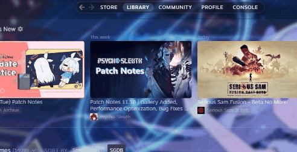
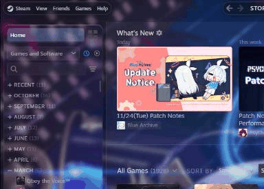
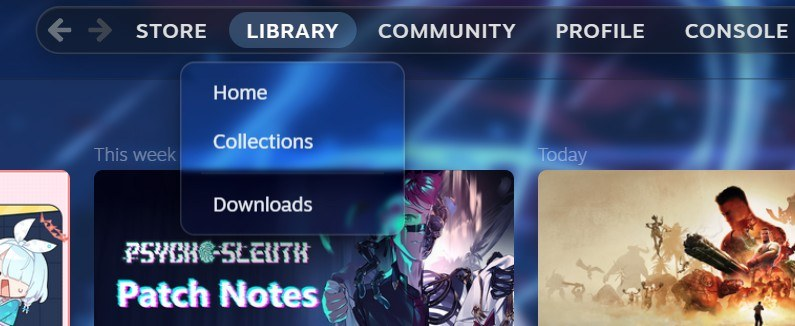
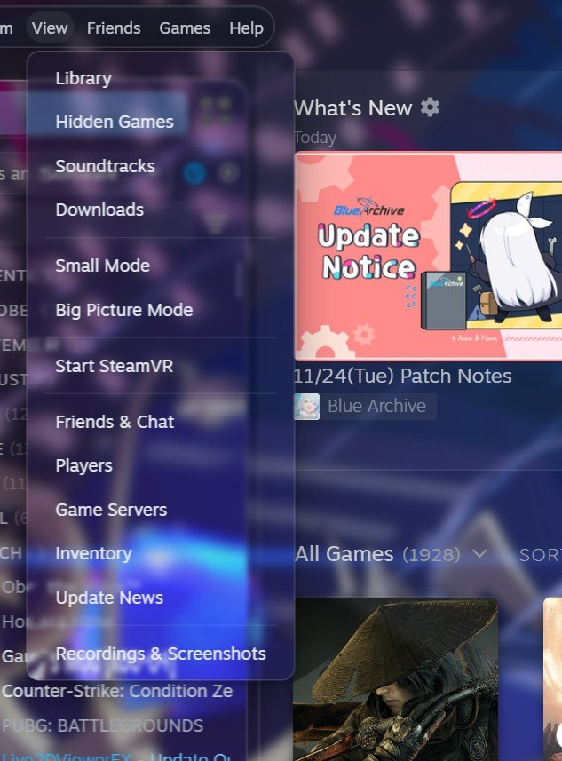
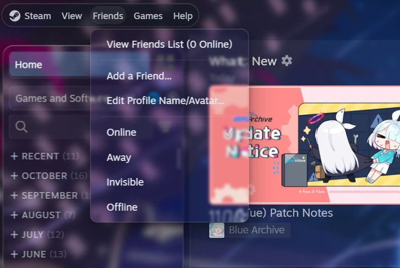
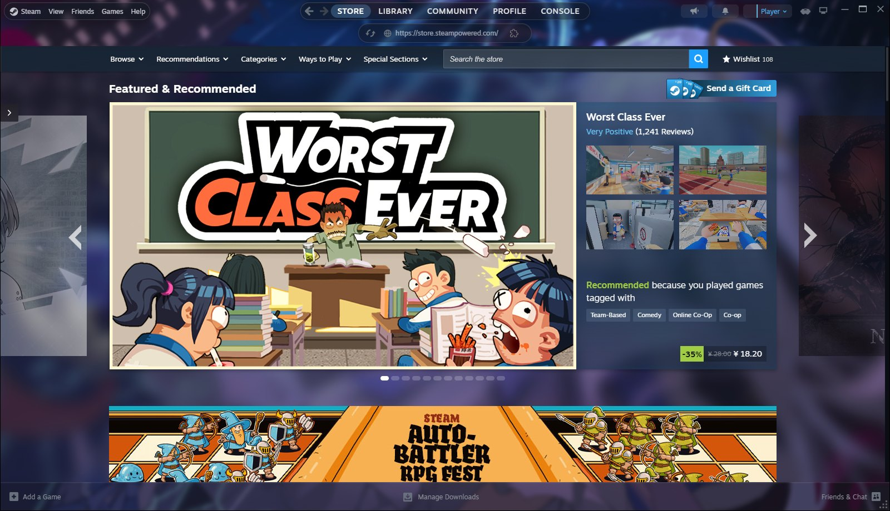

# Lumina · 流光

基于 [Millennium](https://steambrew.app) 的 Steam 桌面客户端主题：半透明的玻璃面板和菜单，背后是会动的壁纸。

[English](README.md)

| 变形导航菜单 | 标题栏菜单 |
|---|---|
|  |  |

| | | |
|---|---|---|
|  |  |  |

| 游戏详情页 | 商店 |
|---|---|
|  |  |

安装 Millennium 后，从 [Releases](../../releases) 下载，把 `lumina` 放进 `Steam\millennium\themes`（插件 `lumina-extended` 可选，放进 `Steam\millennium\plugins`）。

## 设置项

**背景**

- **背景**：玻璃后面显示什么。*壁纸*（默认）是你自己的图片、视频或 Wallpaper Engine 的 Scene；*极光*是跟随强调色的流动渐变；*亚克力*是 Windows 自带的模糊，需要 dwmx 插件。
- **壁纸**：选择图片或视频，或从 Wallpaper Engine 壁纸库里挑。Scene 在 Steam 里实时渲染，其他窗口显示它的静态画面。
- **模糊**：背景的模糊程度（默认 4 px）。

**玻璃**

- **不透明度**：面板的深浅，越低越通透。
- **圆角**：面板、按钮和菜单的圆角大小。
- **游戏栏**：*经典*是贴满左侧的面板；*液态玻璃*让游戏栏悬浮，边缘折射背后的画面，菜单也随之变成液态玻璃。
- **液态玻璃不透明度**、**折射强度**（仅液态玻璃）：悬浮玻璃的着色深浅，以及背景从边缘向内弯折的范围。
- **强调色**、**玻璃着色**：选中项的颜色和面板的底色。

**动效**

- **菜单动画**：*级联*让菜单逐项展开、分类逐行展开；*淡入*只做淡入；*关闭*不做动画。
- **导航菜单**：*变形*用一个面板在商店、库、社区、个人资料之间滑动切换，标题栏菜单和账户菜单也用它；*原生*保留 Steam 自己的弹窗。
- **平滑滚动**：游戏列表的鼠标滚轮平滑。
- **壁纸鼠标响应**：Wallpaper Engine 的 Scene 跟随鼠标（视差、光标特效）。

插件 Lumina Extended 直接读取本机的 Wallpaper Engine 壁纸库（不复制文件，支持网页壁纸），并在商店、社区页面后面显示你的壁纸。

---

与 Valve、Steam、Wallpaper Engine 无关联。默认壁纸为第三方插画。Scene 由 [webwallgl](https://github.com/oneincase/webwallgl)（MIT）渲染。详见 [NOTICE.md](NOTICE.md)。
