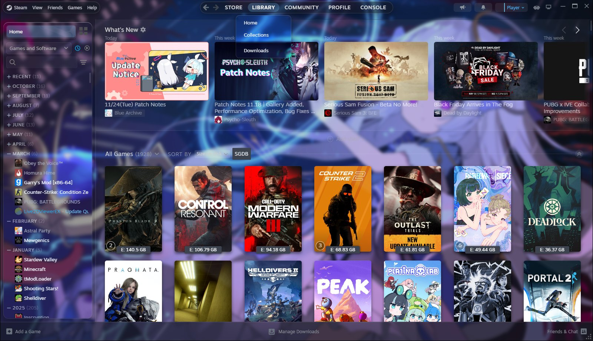
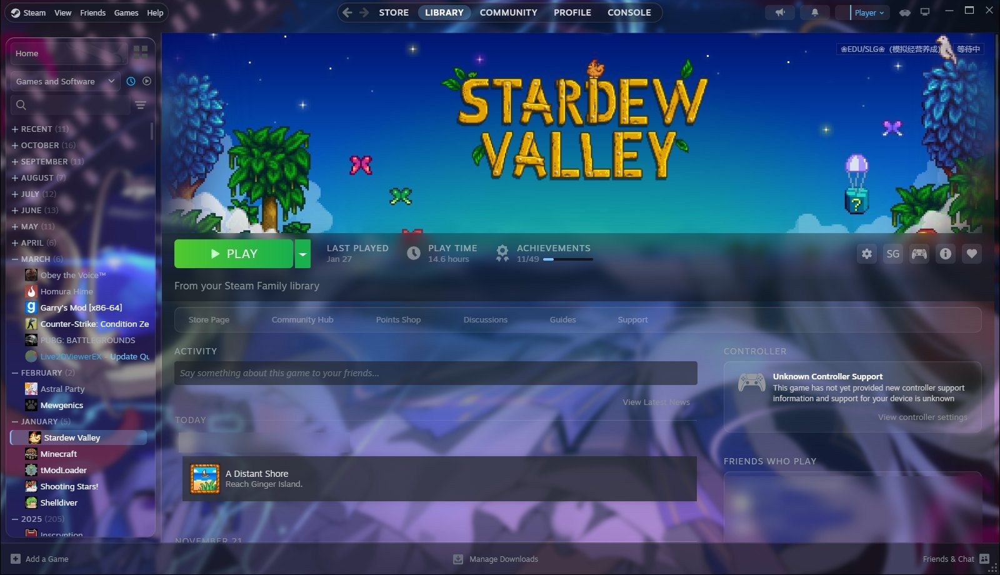

# Lumina · 流光

基于 [Millennium](https://steambrew.app) 的 Steam 桌面客户端主题：半透明的玻璃面板和菜单，背后是动态壁纸。

[English](README.md)

安装 Millennium 后，从 [Releases](../../releases) 下载，把 `lumina` 放进 `Steam\millennium\themes`；插件 `lumina-extended` 可选，放进 `Steam\millennium\plugins`。

## 设置项

**背景**

- **背景**：玻璃后面的内容。*极光*（默认）是代码绘制、跟随强调色的动态极光；*壁纸*可用图片、视频或 Wallpaper Engine 的 Scene；*桌面亚克力*是 Windows 系统桌面模糊，需要启用配套插件 Lumina Extended。
- **壁纸**：选择图片或视频，或从 Wallpaper Engine 壁纸库中挑选。Scene 在 Steam 里实时渲染，其他窗口显示它的静态画面。
- **模糊**：背景的模糊程度（默认 0 px）。
- **壁纸鼠标响应**：Wallpaper Engine 的 Scene 跟随鼠标（视差、光标特效）。
- **桌面模糊**（仅桌面亚克力背景）：*轻模糊*（默认）采用更轻的系统模糊，保留更多桌面轮廓；*强模糊*为更重的磨砂亚克力。

**界面**

- **玻璃材质**：*液态玻璃*（默认）在边缘折射背后画面并带彩色色散（库左右面板采用 WebGL 加速）；*亚克力*为磨砂模糊，带细微噪点。两种材质共用悬浮圆角卡片、顶栏胶囊与悬浮底栏布局。
- **液态玻璃不透明度**、**折射强度**（仅液态玻璃）：悬浮玻璃的着色深浅（默认 30%），以及背景从边缘向内弯折的范围（默认 55%）。
- **模糊**（仅亚克力）：面板和菜单对背后内容的模糊程度（默认 2px），胶囊略轻。
- **不透明度**：面板的深浅，数值越低越通透。
- **圆角**：面板、按钮和菜单的圆角大小。
- **导航位置**：商店、库、社区胶囊的位置。*居中*在标题栏里（窗口太窄时换到第二行）；*第二行靠左*、*第二行靠右*放在第二行，网页上 URL 栏在同一行的另一端。
- **URL 栏**：*常驻*（默认）在库等 Steam 页面也保留 Steam 的 URL 栏，显示页面路径（如 `steam://library/home`，点击即复制），切换页面时布局不跳动；*仅网页*只在商店、社区等网页上显示。
  URL 栏末尾有一个笔按钮，点了可以直接编辑地址：输入网址或 `steam://` 链接后回车跳转。
- **强调色**、**玻璃着色**：选中项的颜色和面板的底色。

**动效**

- **菜单动画**：*级联*使菜单逐项展开、分类逐行展开；*淡入*为淡入效果；*关闭*则不播放动画。
- **导航菜单**：*变形*由一个面板在商店、库、社区、个人资料之间滑动切换，标题栏菜单和账户菜单同样使用；*原生*保留 Steam 自带的弹窗。
- **平滑滚动**：游戏列表和右侧库页面的鼠标滚轮平滑。

插件 Lumina Extended 直接读取本机的 Wallpaper Engine 壁纸库（不复制文件，支持网页壁纸），在商店、社区页面后显示当前壁纸，并提供 64 位兼容的 Windows 桌面亚克力支持（无需再安装 dwmx 插件）。

---

与 Valve、Steam、Wallpaper Engine 无关联。默认壁纸为第三方插画。Scene 由 [webwallgl](https://github.com/oneincase/webwallgl)（MIT）渲染。
